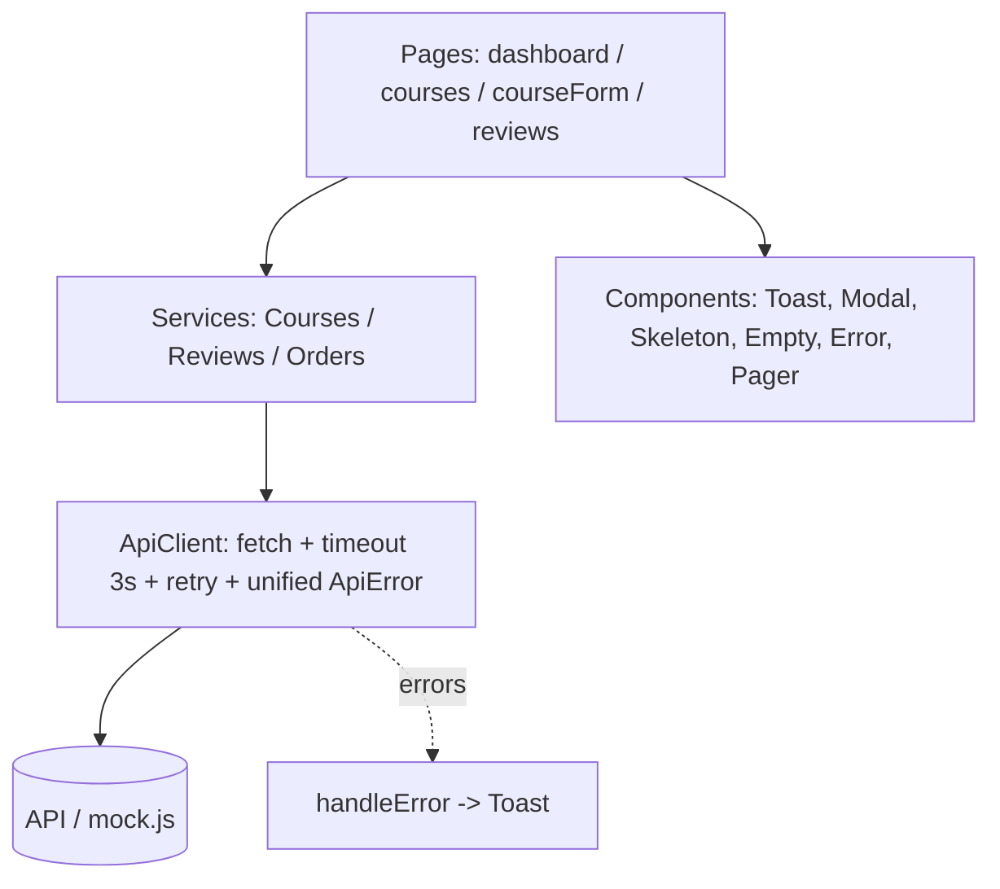

# Instructor Dashboard
Vanilla JS, no build step. Open `index.html` (a mock API intercepts `fetch('/api/...')`; delete `js/mock.js` to point at the real Unit 5 API).
Tip: tick "محاكاة فشل الـ API" in the sidebar, then delete a course or toggle publish to see the optimistic rollback.

## Architecture

| Layer | File | Rule |
|---|---|---|
| Pages | js/pages.js | compose services + components, no raw fetch |
| Services | js/services.js | one per resource, no DOM |
| Core | js/core.js | ApiClient, Toast, Modal, state helpers (`UI.load`) |

## Requirements coverage
fetch+async/await everywhere · `Promise.all` on dashboard · timeout (3s) + retry (GET, backoff) · skeleton/empty/error+retry via `UI.load` · live form validation + server field errors · debounced search 300ms · dynamic filters · optimistic delete/toggle with rollback · stale-response guard · toasts on every action.
